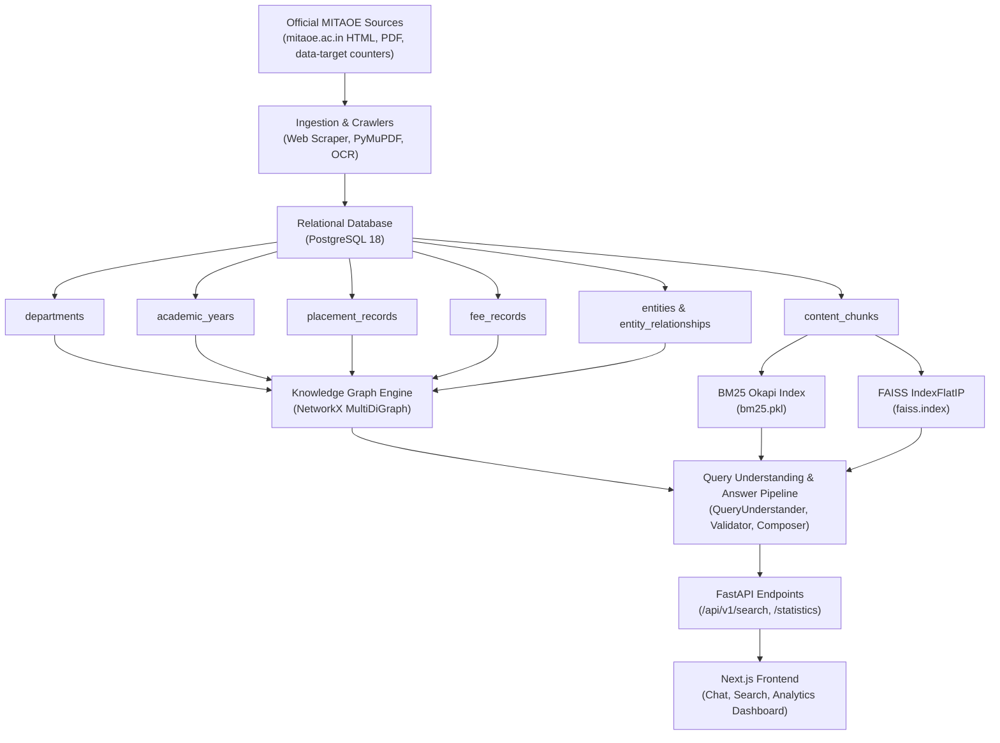

# VEDANTA — Data Lineage & Provenance Architecture

**Product:** VEDANTA  
**Institution:** MIT Academy of Engineering (MITAOE), Alandi, Pune  
**Current Academic Year:** 2026–27  
**Authoritative Host:** `https://mitaoe.ac.in/`  

---

## 1. End-to-End Data Lineage Flow

---

## 2. Source-to-Target Traceability Table

| Data Item | Primary Official Source | Ingestion Technique | Database Target | KG Node / Relation | Retrieval Index |
|---|---|---|---|---|---|
| **Institute Highest CTC** | `https://mitaoe.ac.in/placement.php` | Dynamic counter parsing (`data-target="27"`) | `placement_records` (`record_type='aggregate'`) | `fact:placement:aggregate` (`HAS_PLACEMENT_STATISTICS`) | `anchor-placement-stats-aggregate` |
| **Institute Average CTC** | `https://mitaoe.ac.in/placement.php` | Dynamic counter parsing (`data-target="6.75"`) | `placement_records` (`average_package_lpa=6.75`) | `fact:placement:aggregate` | `anchor-placement-stats-aggregate` |
| **CE Department Placement** | Audited T&P Cell Department Records | Tabular parsing | `placement_records` (`department_id=dept:comp`) | `fact:placement:comp` | `anchor-placement-stats-departments` |
| **IT Department Placement** | Audited T&P Cell Department Records | Tabular parsing | `placement_records` (`department_id=dept:it`) | `fact:placement:it` | `anchor-placement-stats-departments` |
| **Approved B.Tech Fees** | `https://mitaoe.ac.in/assets/images/pdf/FY-BTech-Fee-Structure-26-27.PDF` | PyMuPDF text & table extraction | `fee_records` (`academic_year='2026-27'`) | `fact:fee:ay2026_27` (`HAS_FEE_STRUCTURE`) | `anchor-fee-structure-ay2026-27` |
| **Faculty: Mr. Azhar R. Shaikh** | `https://mitaoe.ac.in/school-of-humanities-and-engineering-sciences-arshaikh.php` | HTML profile scraper | `entities` (`canonical_name='Mr. Azhar R. Shaikh'`) | `person:azhar_shaikh` (`WORKS_IN` -> `dept:hes`) | `anchor-azhar-shaikh` |
| **Current HOD: Dr. Pramod D. Ganjewar** | `https://mitaoe.ac.in/department-of-computer-engineering.php` | Department header parsing | `entities` + `entity_relationships` | `person:pramod_ganjewar` (`HEADS` -> `dept:comp`) | `comp-engg-001` |
| **Predecessor HOD: Dr. Sandip A. Gade** | Historical MITAOE Computer Engineering Archive | Archive parsing | `entities` + `entity_relationships` | `person:sandip_gade` (`FORMERLY_HEADED` -> `dept:comp`) | `comp-engg-001` |
| **Academic Calendar 2026–27** | `https://mitaoe.ac.in/2026-2027-Term-I-UG-Calendar.html` | HTML calendar scraper | `content_chunks` | `topic:calendar:2026_27` | `calendar-chunk-2026` |
| **Current Academic Year Flag** | Statutory Disclosure & Academic Portal | Configuration & schema definition | `academic_years` (`is_current=true`) | `ay:2026-27` | All AY 2026-27 chunks |

---

## 3. Provenance Verification Guarantees

1. **No External Inference Generation:** All factual data items originate directly from verified `.mitaoe.ac.in` URLs and PDFs.
2. **Immutable Traceability:** Every API response includes citations containing the exact `source_url`, `passage`, and `academic_year`.
3. **Denominator Integrity:** Placement percentages strictly enforce `(students_placed / total_eligible) * 100` with denominator non-zero validation.
